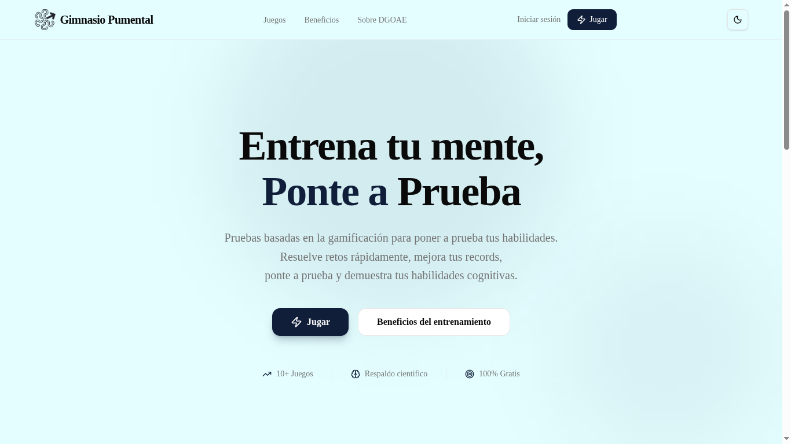
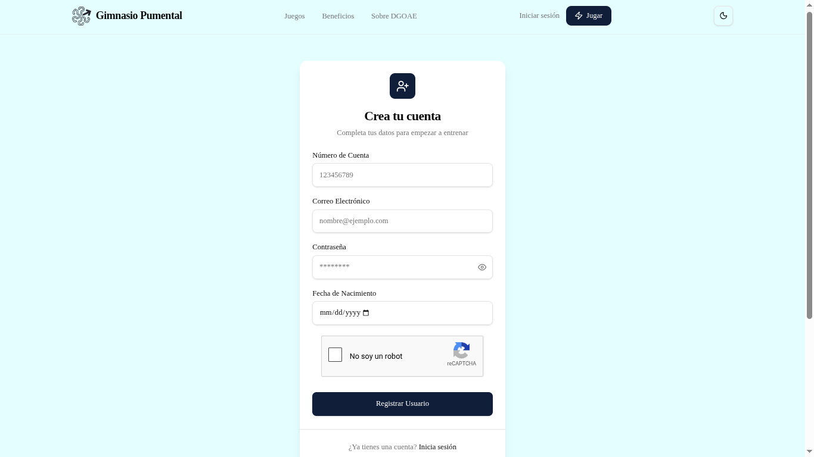

# Gimnasio Mental

> Plataforma web gamificada para evaluar y entrenar las habilidades cognitivas de estudiantes de bachillerato, a partir de la Teoría del Marco Relacional (RFT) y el entrenamiento de Respuestas Relacionales Derivadas (RRD).

[](https://react.dev/)
[](https://www.typescriptlang.org/)
[](https://expressjs.com/)
[](https://www.prisma.io/)
[](https://mariadb.org/)
[](https://phaser.io/)

---

## Tabla de contenidos

1. [Contexto y problema](#1-contexto-y-problema)
2. [Arquitectura del sistema](#2-arquitectura-del-sistema)
3. [Modelo de dominio](#3-modelo-de-dominio)
4. [Motor de gamificación](#4-motor-de-gamificación)
5. [Flujo de una partida](#5-flujo-de-una-partida)
6. [Decisiones de diseño y compensaciones](#6-decisiones-de-diseño-y-compensaciones)
7. [Backend](#7-backend)
8. [Frontend](#8-frontend)
9. [Base de datos](#9-base-de-datos)
10. [Referencia de API](#10-referencia-de-api)
11. [Stack tecnológico](#11-stack-tecnológico)
12. [Estructura del repositorio](#12-estructura-del-repositorio)
13. [Estado actual y hoja de ruta](#13-estado-actual-y-hoja-de-ruta)
14. [Créditos](#14-créditos)

---

## Galería

<!-- --------------------------------------------------------------------------
  CAPTURAS (placeholders)
  Reemplaza estas rutas por imágenes reales de la aplicación.
  Sugerencia: crea la carpeta docs/screenshots/ en la raíz del repositorio
  y nombra los archivos como se indica aquí.
--------------------------------------------------------------------------- -->


*Placeholder: página de inicio con la propuesta de valor y las categorías.*


*Placeholder: formulario de inicio de sesión.*


*Placeholder: dashboard con tarjetas de puntuación, árbol de habilidades y actividades.*


*Placeholder: actividad "Relación-ando" en ejecución.*


*Placeholder: pantalla de puntuación y estadísticas por dificultad.*

---

## 1. Contexto y problema

El **Gimnasio Mental** nace en la **Dirección General de Orientación y Atención Educativa (DGOAE)** de la **Universidad Nacional Autónoma de México (UNAM)**, como respuesta a una necesidad real: los estudiantes de bachillerato presentan dificultades de aprendizaje que no se detectan ni se atienden de forma sistemática, y las herramientas tradicionales de evaluación cognitiva suelen ser poco motivantes y difíciles de escalar.

El proyecto se fundamenta en la **Teoría del Marco Relacional (RFT)** y, en particular, en el entrenamiento de las **Respuestas Relacionales Derivadas (RRD)**: la capacidad de una persona para inferir relaciones entre estímulos sin haber sido entrenada explícitamente en cada una de ellas (por ejemplo, si A = B y B = C, entonces A = C). Este tipo de razonamiento es transversal al aprendizaje escolar y se puede entrenar mediante **juegos serios** y **gamificación**.

El sistema busca que los estudiantes:

- Pongan a prueba y fortalezcan **8 habilidades cognitivas**: coordinación, comparación, oposición, espacial, temporal, condicionalidad, jerárquico y deíctico.
- Tengan un **seguimiento objetivo** de su progreso a lo largo del tiempo.
- Se mantengan motivados mediante puntuaciones, medallas, combos y un árbol de habilidades.
- Generen datos útiles para los orientadores de la DGOAE.

Un objetivo igual de importante es que el **Departamento de Instrumentos de Orientación** pueda incorporar nuevas actividades y reactivos **sin modificar el código**: el contenido vive en la base de datos y el sistema lo sirve dinámicamente. El proyecto se desarrolló durante el servicio social (480 horas) y se probó con usuarios piloto para ajustar la navegación y la experiencia.

---

## 2. Arquitectura del sistema

El sistema sigue una arquitectura **cliente-servidor** desacoplada, con un motor de videojuegos embebido en el cliente y una API REST como única vía de acceso a los datos.

```
                          ┌───────────────────────────────┐
                          │   ESTUDIANTE (navegador)      │
                          └──────────────┬────────────────┘
                                         │ HTTPS · REST · cookies JWT
                                         ▼
┌────────────────────────────────────────────────────────────────────────────┐
│                     CLIENTE — React 19 + Vite + Tailwind                   │
│                                                                            │
│  PublicLayout / PrivateLayout ──► Pages ──► Hooks ──► Axios ──► API REST   │
│         │                                                                  │
│         ▼                                                                  │
│  Motor de actividades (Phaser 4)                                           │
│         │  EventBus ('partida-terminada')                                  │
│         └──────────────────► useGuardarPartida ──► POST /partida           │
└────────────────────────────────────┬───────────────────────────────────────┘
                                     │ JSON · HTTP
                                     ▼
┌────────────────────────────────────────────────────────────────────────────┐
│                  BACKEND — Node.js + Express + TypeScript                  │
│                                                                            │
│   routes ──► middlewares ──► controllers ──► Prisma ORM                    │
│               ├── validateToken (JWT en cookie)                            │
│               ├── validateSchema (Zod)                                     │
│               └── errorHandler (CustomError + diccionario)                 │
└────────────────────────────────────┬───────────────────────────────────────┘
                                     │ SQL
                                     ▼
                        ┌─────────────────────────────┐
                        │   MariaDB (MySQL)           │
                        │   banco de reactivos +      │
                        │   partidas + estadísticas   │
                        └─────────────────────────────┘
```

**Capas y responsabilidades**

| Capa | Responsabilidad |
|------|-----------------|
| Cliente | Interacción, navegación, presentación y ejecución de las actividades. |
| API REST | Autenticación, validación, lógica de negocio y acceso a datos. |
| Prisma ORM | Mapeo objeto-relacional y consultas seguras a MariaDB. |
| MariaDB | Persistencia normalizada del banco de reactivos, partidas y estadísticas. |

**Puntos clave de la arquitectura**

- **El contenido no está en el código**: las categorías, actividades, ítems y respuestas se sirven desde la base de datos.
- **Phaser es un módulo aislado**: cada actividad es un mini-proyecto con sus escenas y assets, y se importa dinámicamente por ID.
- **EventBus como puente**: la escena de resultados emite un evento y React decide cuándo guardar la partida en el backend.
- **API única vía de acceso**: el cliente nunca consulta la base de datos directamente.

---

## 3. Modelo de dominio

El modelo refleja el dominio educativo: un **banco de reactivos** organizado por categorías y actividades, y un historial de **partidas** con estadísticas por dificultad.

```
┌──────────────────┐        ┌────────────────────┐
│ cat_categoria    │        │      usuario       │
│──────────────────│        │────────────────────│
│ id_categoria (PK)│        │ id_usuario (PK)    │
│ nombre (UQ)      │        │ num_cta (UQ)       │
│ beneficios       │        │ email (UQ)         │
│ slug (UQ)        │        │ password (hash)    │
│ portada          │        │ fecha_nacimiento   │
└────────┬─────────┘        │ fecha_registro     │
         │ 1                └─────────┬──────────┘
         │                            │ 1
         ▼ N                          │
┌──────────────────┐                  │ N
│    actividad     │                  │
│──────────────────│                  │
│ id_actividad(PK) │                  │
│ id_categoria(FK) │                  │
│ nombre (UQ)      │                  │
│ explicacion      │                  │
│ tiempoLimite     │                  │
│ slug (UQ)        │                  │
│ estatus_actividad│                  │
└────────┬─────────┘                  │
         │ 1                          │
         ▼ N                          │
┌──────────────────┐                  │
│      item        │                  │
│──────────────────│                  │
│ id_item (PK)     │                  │
│ id_actividad(FK) │                  │
│ pregunta         │                  │
│ dificultad (ENUM)│                  │
│ estatus_activo   │                  │
└────────┬─────────┘                  │
         │ 1                          │
         ▼ N                          │
┌──────────────────┐                  │
│    respuesta     │                  │
│──────────────────│                  │
│ id_respuesta(PK) │                  │
│ id_item (FK)     │                  │
│ text_respuesta   │                  │
│ correcta         │                  │
│ activo           │                  │
└──────────────────┘                  │
                                      │
┌──────────────────┐                  │
│     partida      │                  │
│──────────────────│                  │
│ id_partida (PK)  │◄─────────────────┘
│ id_actividad(FK) │
│ id_usuario (FK)  │
│ puntuacion       │
│ fecha            │
└────────┬─────────┘
         │ 1
         ▼ 1
┌──────────────────┐
│   estadistica    │
│──────────────────│
│ id_partida (PK)  │
│ aciertos_facil   │
│ total_facil      │
│ aciertos_medio   │
│ total_medio      │
│ aciertos_dificil │
│ total_dificil    │
└──────────────────┘

usuario  }o--o{  actividad  : stat_usuario  (progreso, PK compuesta)
```

**Reglas y cardinalidades relevantes**

- Una **categoría** agrupa N actividades; cada actividad pertenece a una sola categoría.
- Una **actividad** tiene N ítems; cada ítem pertenece a una sola actividad (entidad débil).
- Un **ítem** tiene N respuestas; solo una es la correcta.
- Un **usuario** realiza N partidas; cada partida corresponde a una actividad y a un usuario.
- Una **partida** tiene exactamente una **estadística** (relación 1:1, con FK que es PK).
- El **progreso** entre usuario y actividad es N:M con PK compuesta (`stat_usuario`), lo que permite guardar récord personal y número de partidas por actividad.
- La **dificultad** es un enumerado (`FACIL`, `MEDIO`, `DIFICIL`) con mapeo a la base de datos (`1`, `2`, `3`).

---

## 4. Motor de gamificación

El núcleo del producto no es el renderizado, sino un **sistema de evaluación adaptativa** que mantiene al estudiante en una zona de desafío adecuada y convierte cada sesión en datos aprovechables.

### 4.1 Dificultad adaptativa (máquina de estados)

La actividad comienza en nivel **FÁCIL** y se ajusta según el desempeño reciente:

```
        3 aciertos            3 aciertos
┌───────────┐ ───────────► ┌───────────┐ ───────────► ┌───────────┐
│   FÁCIL   │              │   MEDIO   │              │  DIFÍCIL  │
└───────────┘ ◄─────────── └───────────┘ ◄─────────── └───────────┘
        2 errores                2 errores
```

- **3 aciertos seguidos** → sube de nivel.
- **2 errores seguidos** → baja de nivel.
- Esto evita la frustración (baja cuando falla) y el aburrimiento (sube cuando acierta), manteniendo el flujo.

### 4.2 Puntuación, combo y decaimiento

```
puntuacion += 100 × multiplicadorDificultad × multiplicadorCombo

multiplicadorDificultad = 1    (FÁCIL)
                          1.5  (MEDIO)
                          2    (DIFÍCIL)

multiplicadorCombo = min(floor(energiaCombo / 200) + 1, 5)
```

- El **combo** acumula energía con aciertos (+300) y la pierde con errores (−150).
- La energía **se drena en 20 segundos** si no se responde bien, por lo que la racha debe mantenerse.
- El multiplicador de combo tope es **x5**, premiando la constancia sin romper el balance.

### 4.3 Aleatorización

- Los ítems se agrupan por dificultad y se **barajan en cada sesión** (Fisher-Yates).
- Las opciones de respuesta también se aleatorizan.
- Resultado: evita la memorización del orden y reduce el sesgo de posición.

### 4.4 Analítica de progreso

Cada partida envía al backend los aciertos y totales por dificultad. El backend calcula un **porcentaje ponderado por actividad**:

```
porcentajeActividad = (A × 0.2 + B × 0.3 + C × 0.5) × 100

A = aciertosFacil   / totalesFacil    (solo si aciertosFacil   >= 3)
B = aciertosMedio   / totalesMedio    (solo si aciertosMedio   >= 3)
C = aciertosDificil / totalesDificil  (solo si aciertosDificil >= 3)
```

- Se considera el **mejor porcentaje histórico** por actividad.
- El aporte de cada actividad a su categoría es `mejorPorcentaje / numeroDeActividades`.
- El dashboard lo transforma en tarjetas, medallas (bronce/plata/oro en 30 %, 60 % y 100 %) y un **radar de habilidades** (árbol de habilidades en la versión de producto).

---

## 5. Flujo de una partida

```
 Estudiante     React (hooks)      API Express        MariaDB       Phaser
     │               │                  │                │            │
     │  entra a la   │                  │                │            │
     │  actividad    │                  │                │            │
     ├──────────────►│  GET /actividades│                │            │
     │               ├─────────────────►│                │            │
     │               │                  ├───────────────►│            │
     │               │◄─────────────────┤  actividad     │            │
     │               │  GET /actividad/:id (items)        │            │
     │               ├─────────────────►│                │            │
     │               │◄─────────────────┤  reactivos     │            │
     │               │  createGame(items)               │            │
     │               ├──────────────────────────────────────────────►│
     │               │                  │                │  partida   │
     │               │                  │                │ adaptativa │
     │               │  EventBus: 'partida-terminada'     │            │
     │               │◄───────────────────────────────────────────────┤
     │               │  POST /partida   │                │            │
     │               ├─────────────────►│                │            │
     │               │                  ├───────────────►│            │
     │               │◄─────────────────┤  201 Created   │            │
     │               │  GET /partida/puntuacion/usuario/:id         │
     │               ├─────────────────►│                │            │
     │               │◄─────────────────┤  progreso      │            │
     │  dashboard    │                  │                │            │
     │◄──────────────┤                  │                │            │
```

**Lectura del flujo**

1. El estudiante navega por rutas con **slug** (`/usuario/categorias/:categoria/:actividad`).
2. React obtiene la actividad y sus reactivos del backend.
3. Se carga dinámicamente la configuración de Phaser para esa actividad y se crea el juego con los ítems.
4. La `PlayScene` ejecuta la lógica adaptativa y de puntuación.
5. La `ScoreScene` emite `partida-terminada` por el `EventBus`.
6. El hook `useGuardarPartida` escucha el evento y persiste la partida y sus estadísticas.
7. El dashboard consulta el progreso y lo visualiza.

---

## 6. Decisiones de diseño y compensaciones

| Decisión | Por qué | Compensación / consecuencia |
|----------|---------|-----------------------------|
| **Banco de reactivos como datos** | El departamento de orientación puede añadir preguntas sin tocar código. | Se pierde tipado fuerte sobre el contenido; se compensa con validación en la API y convenciones de datos. |
| **API REST + cliente-servidor** | Separación de responsabilidades, escalabilidad y posibilidad de otros clientes. | Mayor complejidad que una app monolítica; se justifica por el crecimiento esperado. |
| **Dificultad adaptativa** | Mantiene la motivación y evita frustración o aburrimiento. | Requiere un banco de ítems con suficientes reactivos por nivel. |
| **Combo con decaimiento** | Premia rachas y añade tensión, reforzando la práctica. | Puede penalizar a usuarios lentos; se limita con un tope de x5. |
| **Aleatorización por dificultad** | Evita memorización y sesgos de orden. | Dificulta reproducir una partida exacta para depuración. |
| **Estadística 1:1 con partida** | Mantiene la tabla principal ligera y la información detallada normalizada. | Requiere una consulta adicional o un `include` al recuperar partidas. |
| **Slugs en rutas** | Desacopla nombres de la base de datos de las rutas; cambios de contenido no rompen URLs. | Hay que mantener slugs únicos y estandarizados. |
| **Carga dinámica de juegos** | Evita descargar código y assets de actividades que no se usan; facilita añadir juegos. | Cada actividad es un módulo adicional que debe mantener su propia estructura de escenas. |
| **JWT en cookie + bcrypt** | Sesión persistente sin exponer el token en el almacenamiento local. | Requiere configuración cuidadosa de cookies (ver hoja de ruta). |
| **Manejo centralizado de errores** | Respuestas consistentes y mensajes controlados en producción. | El diccionario de errores debe mantenerse actualizado. |
| **PK compuesta en `stat_usuario`** | Modela la relación N:M con atributos (récord, partidas). | Las consultas de progreso requieren agrupaciones. |
| **Flags de estatus** | Borrado lógico sin perder historial. | Las consultas deben filtrar por estatus en todos los casos. |

---

## 7. Backend

**Stack:** Node.js + Express 5 + TypeScript + Prisma ORM + MariaDB.

### Organización por capas

```
routes/        → definición de endpoints
middlewares/   → validateToken (JWT), validateSchema (Zod), errorHandling
controllers/   → lógica de negocio por entidad
schemas/       → esquemas de validación con Zod
utils/         → CustomError, diccionario de errores, utilidades de dominio
libs/          → generación de JWT
config/        → conexión de Prisma y variables de entorno validadas
```

### Autenticación

- **Registro**: valida campos con Zod, verifica reCAPTCHA v2 en servidor, comprueba unicidad de correo y número de cuenta, y cifra la contraseña con **bcrypt (cost 12)**.
- **Login**: compara la contraseña con bcrypt y emite un **JWT (expira en 1 día)**.
- **Sesión**: el JWT se entrega en una **cookie** y el middleware `validateToken` lo verifica antes de permitir el acceso a rutas protegidas.
- **Autorización**: los endpoints que requieren sesión usan `authRequired` y leen el usuario desde `req.usuario`.

### Validación y errores

- **Zod** valida la entrada antes de llegar al controlador.
- **`CustomError`** + diccionario de errores generan respuestas HTTP con código, mensaje y fecha.
- En producción se ocultan los detalles internos; en desarrollo se incluye el stack trace.

### Seguridad implementada

- Contraseñas cifradas con bcrypt.
- JWT en cookie y verificación en middleware.
- reCAPTCHA v2 para evitar registros automatizados.
- Validación del número de cuenta (9 dígitos) en esquema y en base de datos (constraint).
- Consultas a través de Prisma (parametrizadas, reduce riesgo de inyección SQL).
- Encabezado `X-Powered-By` deshabilitado.

---

## 8. Frontend

**Stack:** React 19 + Vite + TypeScript + Tailwind CSS + React Router + Phaser 4.

### Estructura

- **Layouts**: `PublicLayout` (login/registro) y `PrivateLayout` (aplicación autenticada), con rutas protegidas.
- **Pages**: inicio, login, registro, dashboard, categorías, actividades y juego.
- **Hooks personalizados**: encapsulan el consumo de la API y manejan estados de carga y error (`useCategorias`, `useActividades`, `useItems`, `useUserScores`, `useGuardarPartida`, `useJuegoPhaser`).
- **Context**: `AuthContext` administra sesión, registro, login y errores.
- **Componentes UI reutilizables**: navbar, breadcrumb, tarjetas, botones, spinner, tema claro/oscuro.
- **Phaser**: cada actividad es un mini-proyecto con escenas `Preload`, `Menu`, `Title`, `Play` y `Score`, y assets aislados por actividad.

### Carga dinámica de actividades

El archivo `registroJuegos.ts` actúa como un **registro de plugins**: mapea el ID de la actividad con una importación dinámica de su configuración. Esto permite que solo se descargue el código de la actividad que el estudiante está jugando.

### Dashboard

- Tarjetas de puntuación por categoría, con medallas de bronce/plata/oro.
- **Árbol de habilidades**: gráfico de radar SVG que resume el porcentaje por habilidad.
- Actividades disponibles y acceso directo a cada una.

---

## 9. Base de datos

**Motor:** MariaDB (compatible con MySQL).

- **Normalización**: el banco de reactivos se separa en `actividad → item → respuesta`, y el historial en `partida → estadistica`.
- **Integridad referencial**: llaves foráneas con `ON DELETE CASCADE` o `RESTRICT` según el caso.
- **Restricciones adicionales**:
  - `num_cta` de exactamente 9 dígitos (CHECK en la base de datos).
  - Unicidad en `email`, `num_cta`, `slug`, nombres de categoría y actividad.
  - Enumerado de dificultad con mapeo explícito.
- **Índices** en llaves foráneas para consultas de progreso y listados.
- **PK compuesta** en `stat_usuario` para modelar el progreso por usuario y actividad.
- **Borrado lógico** mediante `estatus_actividad`, `estatus_activo` y `activo`.
- **Datos semilla** en `db/DDL.sql` y `db/DML.sql`, que permiten reconstruir el esquema y el contenido inicial.

**Contenido semilla:** 8 categorías, 3 actividades, 200 reactivos y 800 incisos, con sus respectivas respuestas correctas.

---

## 10. Referencia de API

Todos los endpoints están bajo `/api`. Los marcados con 🔒 requieren cookie de sesión válida.

| Método | Ruta | Descripción |
|--------|------|-------------|
| POST | `/auth/register` | Registra un nuevo usuario (valida reCAPTCHA). |
| POST | `/auth/login` | Inicia sesión y emite la cookie JWT. |
| POST | `/auth/logout` | Cierra la sesión. |
| GET 🔒 | `/auth/profile` | Obtiene el perfil del usuario autenticado. |
| GET | `/auth/verify` | Verifica la cookie y devuelve el usuario. |
| PUT 🔒 | `/auth/profile` | Actualiza información del perfil. |
| GET | `/categorias` | Lista todas las categorías. |
| GET | `/categorias/:id` | Obtiene una categoría por ID. |
| GET | `/actividades` | Lista las actividades activas. |
| GET | `/actividades/:id` | Obtiene una actividad por ID. |
| GET | `/categorias/:slug/actividades` | Lista actividades de una categoría por slug. |
| GET | `/actividad/:id` | Obtiene los ítems activos de una actividad. |
| POST 🔒 | `/partida` | Guarda una partida con sus estadísticas. |
| GET | `/partida/usuario/:idUsuario/actividad/:idActividad` | Historial de partidas por usuario y actividad. |
| GET | `/partida/puntuacion/usuario/:idUsuario` | Progreso y puntuación por categoría. |

---

## 11. Stack tecnológico

| Capa | Tecnologías |
|------|-------------|
| Frontend | React 19, Vite, TypeScript, Tailwind CSS, React Router, Axios |
| Motor de juegos | Phaser 4 |
| Backend | Node.js, Express 5, TypeScript |
| Base de datos | MariaDB |
| ORM | Prisma |
| Autenticación | JWT, bcrypt, reCAPTCHA v2 |
| Validación | Zod |
| Estilos | Tailwind CSS, Radix UI, Lucide icons |

---

## 12. Estructura del repositorio

```
GimnasioMental/
├── client/                      # Frontend (React + Vite + Phaser)
│   ├── public/                  # assets, imágenes y sonidos de las actividades
│   └── src/
│       ├── api/                 # cliente Axios y funciones por entidad
│       ├── components/          # componentes UI, layouts de navegación y Phaser
│       ├── context/             # AuthContext
│       ├── hooks/               # hooks de consumo de API y lógica de juegos
│       ├── layouts/             # PublicLayout y PrivateLayout
│       ├── lib/                 # utilidades y cálculo de puntajes
│       ├── pages/               # páginas de la aplicación
│       ├── phaser/              # actividades (escenas, assets y lógica)
│       ├── router.tsx           # definición de rutas
│       └── types/               # tipos de TypeScript
├── src/                         # Backend (Express + TypeScript)
│   ├── config/                  # Prisma y variables de entorno
│   ├── controllers/             # lógica de negocio por entidad
│   ├── libs/                    # JWT
│   ├── middlewares/             # autenticación, validación y errores
│   ├── routes/                  # endpoints de la API
│   ├── schemas/                 # esquemas de Zod
│   ├── utils/                   # errores, diccionario y utilidades
│   ├── app.ts                   # configuración de Express
│   └── index.ts                 # punto de entrada
├── db/                          # DDL y DML (esquema y datos semilla)
├── prisma/                      # esquema de Prisma
└── README.md
```

---

## 13. Estado actual y hoja de ruta

El proyecto tiene la **infraestructura principal completa y funcionando**: autenticación, catálogo de categorías y actividades, banco de reactivos, motor de actividades con dificultad adaptativa, persistencia de partidas y dashboard de progreso.

### Mejoras identificadas

- **Pruebas automatizadas** (unitarias y de integración) para el backend y la lógica de puntuación.
- **CI/CD** y contenedorización con Docker.
- **Cookies más seguras**: agregar `httpOnly`, `secure` y `SameSite`.
- **Protección de endpoints de partidas**: aplicar `authRequired` a las consultas por ID de usuario.
- **Variables de entorno** para las URLs del backend y el origen de CORS (hoy fijas a `localhost`).
- **Refactorización de páginas placeholder** (Perfil, Ajustes) y eliminación de datos de ejemplo hardcodeados.
- **Uso de `tiempoLimite`** definido por actividad en lugar del tiempo fijo en la escena de juego.
- **Completar las 8 categorías** con sus actividades y reactivos, y añadir rankings y medallas globales.
- **Archivo de seed** (`prisma/seed.ts`): referenciado en la configuración pero pendiente de implementar.

Estas mejoras reflejan el trabajo que queda por hacer y sirven como guía para el crecimiento del sistema.

---

## 14. Créditos

Este proyecto fue desarrollado como parte del **Servicio Social** de **Marcos Julián Noriega Rodríguez** (número de cuenta 319284061), estudiante de la licenciatura en **Ciencias de la Computación** de la **Facultad de Ciencias, UNAM**, en el programa **"Automatización e Innovación de Sistemas Web de la DGOAE"** de la **Dirección General de Orientación y Atención Educativa (DGOAE)**, con clave **SS-2025-12/101-2643**.

- **Tutor responsable:** M. en C. Pedro Xavier Contla Romero.
- **Base del proyecto:** *"Proyecto para mejoramiento de habilidades cognitivas para estudiantes de bachillerato: Gimnasio Mental"*, de la Dra. Wendy A. Bautista Montoya y el Mtro. Luis Fernando Borja Hernández.

---

## Licencia

Este proyecto se distribuye bajo la licencia **ISC**.
